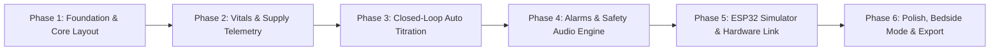

# OxySync Development Roadmap

## Phase Overview

---

### Phase 1: Application Scaffolding & Core Architecture
- **Goal**: Scaffold modern Vite + React + TypeScript + Tailwind CSS application with responsive clinical UI layout, navigation, and state models.
- **Success Criteria**:
  - Clean project structure, dependencies installed, zero build errors.
  - Header with system connectivity status, patient profile, and emergency quick-action bar.
  - Tab/View switcher: Bedside Dashboard, Titration Protocol, Alert Log, Hardware Simulation.

### Phase 2: Real-Time Patient Vitals & Oxygen Supply Telemetry
- **Goal**: Build high-precision vitals cards ($SpO_2$, Pulse Rate), live animated PPG waveform canvas, and oxygen supply telemetry (Cylinder PSI/Bar, Flow L/min, Remaining Volume, and dynamic Runtime estimation).
- **Success Criteria**:
  - 60 FPS animated SVG/Canvas PPG plethysmograph waveform.
  - Dynamic mathematical runtime model calculating exact hours & minutes of oxygen remaining.
  - Oxygen tank visualization with radial gauge and level percentage.

### Phase 3: Doctor-Prescribed Closed-Loop Titration Engine
- **Goal**: Implement the Doctor Prescription Lock interface and safe automated oxygen flow regulation within physician-set bounds.
- **Success Criteria**:
  - Doctor prescription modal with passcode verification, min/max flow bounds, and target $SpO_2$ thresholds.
  - Automatic titration algorithm adjusting flow rate ($L/\text{min}$) smoothly when $SpO_2$ drifts below or above target.
  - Instant manual override toggle and emergency high-flow boost button.

### Phase 4: Clinical Alert System & Web Audio Alarm Engine
- **Goal**: Provide audio-visual alarm management with priority categorization (Critical, Warning, Advisory), snooze countdown, and timestamped event logging.
- **Success Criteria**:
  - Web Audio API alarm sound synthesizer (distinct tones for warning vs critical emergency).
  - Prominent visual flashing banners for urgent hypoxemia or supply failure.
  - 120-second alarm snooze with active timer display and audit trail in event history.

### Phase 5: Interactive Mechatronics & Hardware Simulation Hub
- **Goal**: Build an embedded mechatronics test bench allowing users to simulate real patient scenarios and hardware conditions, plus Web Bluetooth/WebSocket interface for real ESP32 boards.
- **Success Criteria**:
  - One-click clinical scenario triggers: Normal Resting, Severe Hypoxemia, Rapid Tank Depletion, Cannula Disconnect, Exercise Desaturation.
  - Fine-grained parameter sliders to perturb sensor readings in real time.
  - Mock ESP32 serial data packet inspector demonstrating mechatronic telemetry protocol.

### Phase 6: Bedside High-Contrast Mode, Telemetry Export & Production Build
- **Goal**: Finalize production polish, bedside night mode (low-light OLED friendly), data export (JSON/CSV report), responsive mobile layouts, and bundle verification.
- **Success Criteria**:
  - Dark OLED high-contrast bedside mode for nighttime patient rooms.
  - Telemetry export feature generating clinical summary report.
  - Flawless build with 0 TypeScript errors and optimized bundle.
